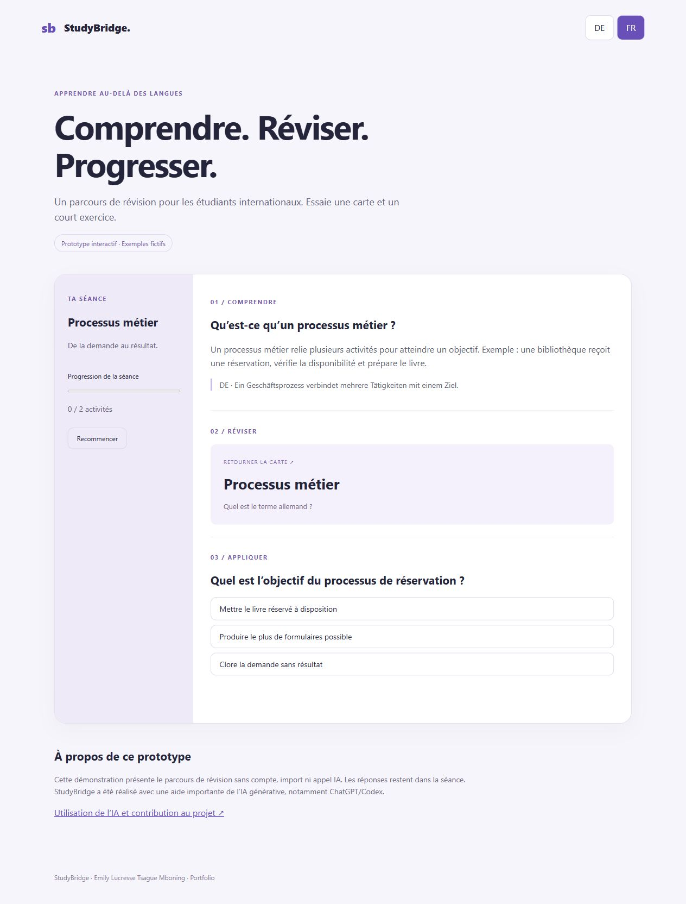

# StudyBridge

**Mehrsprachiger Lernprototyp für internationale Studierende**

StudyBridge verbindet Erklärungen auf Französisch oder Englisch mit deutschen Fachbegriffen. Das Projekt untersucht einen konkreten Lernablauf: Inhalte verstehen, mit Lernkarten wiederholen, Wissen prüfen und den eigenen Fortschritt verfolgen.

**Status:** persönliches Lernprojekt mit umfangreicher KI-Unterstützung. Kein kommerzielles Produkt und keine offizielle Hochschulanwendung.



## Projekt ansehen

- [Interaktiver Portfolio-Prototyp](docs/prototype/index.html): fiktives Beispiel, ohne Anmeldung, API-Schlüssel oder echte Kursunterlagen.
- [Projektbeschreibung und Architektur](docs/PROJEKT-DE.md)
- [KI-Unterstützung und Eigenbeitrag](docs/KI-TRANSPARENZ.md)
- [Installation und technische Dokumentation](README.md)
- [Tests und dokumentierte Prüfungen](docs/TESTS.md)

Die Vorschau lässt sich nach dem Herunterladen direkt im Browser öffnen. Ein Link auf eine HTML-Datei im GitHub-Repository zeigt zunächst deren Quelltext; für eine öffentliche interaktive Vorschau muss `docs/prototype/` separat statisch bereitgestellt werden.

## Problem und Zielgruppe

Internationale Studierende müssen häufig gleichzeitig fachliche Inhalte verstehen und deutsche Begriffe lernen. StudyBridge soll den Wechsel zwischen Erklärungen, Fachwortschatz und Selbsttests in einem Lernablauf zusammenführen.

## Was im vorhandenen Code enthalten ist

| Bereich | Umsetzung |
|---|---|
| Lernen | Zweisprachige Oberfläche, Lernkarten, Quiz und Fortschrittsanzeige |
| Dokumente | PDF-/TXT-/Markdown-Import; PDF-Textauszug im Browser |
| Konten | Eigene Anmeldung, Dokumente und Fortschritt pro Konto |
| Prüfungsvorbereitung | Zeitbegrenzter Übungsmodus; schriftliche Antworten mit Selbsteinschätzung |
| KI-Assistent | Optionale serverseitige Integration; benötigt eigene Konfiguration |
| Lernanimation | Lokales Storyboard und Videoexport; optionale lokale Sprachausgabe |

Die Existenz einer Funktion im Code ist keine Zusage, dass sie produktionsreif ist. Grenzen und Prüfungen stehen in der technischen Dokumentation.

## Technologien

JavaScript, HTML, CSS, Node.js, JSON-Dateispeicherung und PDF.js. Der Server verwendet eingebaute Node.js-Module. Der kleine Portfolio-Prototyp arbeitet vollständig im Browser und ist von der vollständigen Anwendung getrennt.

## Bezug zur Wirtschaftsinformatik

Das Projekt lässt sich anhand von Nutzeranforderungen, Lernprozessen, Datenflüssen und nachvollziehbaren Funktionsgrenzen erklären. Ein fachlich sinnvolles Gespräch darüber ist möglich, ohne die vollständige Softwareentwicklung als Eigenleistung auszugeben.

## Transparenz zur Entstehung

Bei der Entwicklung und Dokumentation wurde generative KI, darunter ChatGPT/Codex, umfangreich eingesetzt. Wesentliche Teile der Implementierung und Dokumentation wurden mit KI-Unterstützung erstellt. Das Projekt wird deshalb als KI-gestütztes Lernprojekt vorgestellt. Welche konkreten Anforderungen, Änderungen und Prüfungen Emily selbst übernommen hat, wird vor einer entsprechenden persönlichen Aussage gesondert festgehalten.

## Lokal starten

Mit Node.js ab der im Projekt angegebenen Version:

```sh
npm start
```

Die Anwendung läuft standardmäßig unter `http://localhost:3000`. Die KI-Funktionen benötigen zusätzlich eine private Serverkonfiguration. Keine API-Schlüssel, Kontodaten oder privaten Kursunterlagen in ein öffentliches Repository übernehmen.
