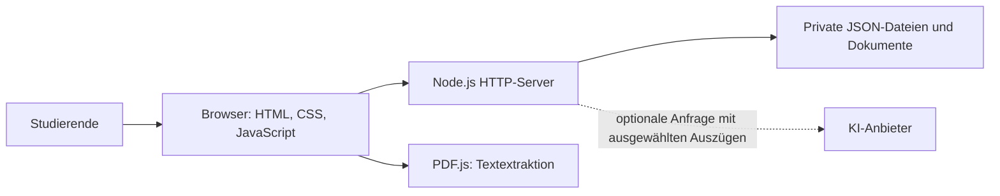

# StudyBridge – Projektdokumentation

## Ziel und Abgrenzung

StudyBridge ist ein KI-gestütztes Lernprojekt für mehrsprachige Prüfungsvorbereitung. Die vollständige Anwendung und der Portfolio-Prototyp haben unterschiedliche Aufgaben: Die Anwendung enthält Konten, Imports und optionale KI-Anbindung; die Vorschau demonstriert einen kurzen Lernablauf mit selbst erstellten Beispieldaten.

## Beispielanforderungen aus der vorhandenen Funktionalität

Diese Anforderungen beschreiben den aktuellen Funktionsumfang. Sie sind keine Behauptung, dass Interviews oder formelle Nutzerstudien stattgefunden haben.

| ID | Anforderung | Überprüfbares Verhalten |
|---|---|---|
| L1 | Fachbegriffe in zwei Sprachen lernen | Eine Karte zeigt Begriff und übersetzte Erklärung |
| L2 | Verständnis selbst prüfen | Ein Quiz zeigt nach der Antwort eine begründete Rückmeldung |
| L3 | Fortschritt nachvollziehen | Abgeschlossene Aktivitäten werden angezeigt |
| D1 | Eigene Dokumente verwenden | Die vollständige Anwendung nimmt unterstützte Dateitypen an |
| D2 | Kontoinhalte voneinander trennen | Zugriff auf private Dokumente erfordert das passende Konto |
| A1 | KI-Unterstützung optional nutzen | Lernen bleibt ohne bezahlten KI-Aufruf möglich |

## Architektur der vollständigen Anwendung

- `public/app.js`: Lernansichten, Karten, Quiz und lokaler Zustand.
- `public/extensions.js`: zusätzliche Lern- und Prüfungsfunktionen.
- `public/portable.js`: Konten und optionale KI-Oberfläche.
- `public/sync.js`: Fortschrittssynchronisation.
- `server.mjs`: HTTP-Endpunkte, Konten, private Dokumente und KI-Anbindung.
- `tests/`: automatisierte Logik- und HTTP-Prüfungen.

## Lernprozess im Portfolio-Prototyp

1. Sprache auswählen.
2. Eine kurze Erklärung zum Geschäftsprozess lesen.
3. Eine Karte umdrehen und den deutschen Begriff wiederholen.
4. Eine Verständnisfrage beantworten.
5. Rückmeldung und Sitzungsfortschritt ansehen.

Die Vorschau speichert keine Daten dauerhaft, sendet keine Nachrichten und ruft keine KI auf. Der Fortschritt gilt nur für die aktuelle Sitzung.

## Bekannte Grenzen

- Kein Nachweis einer pädagogischen Wirkung oder Verbesserung von Prüfungsergebnissen.
- KI-Antworten können fehlerhaft sein; die echte Anbieterintegration ist nicht durch simulierte Tests nachgewiesen.
- Kein OCR für gescannte PDF-Dateien.
- Dateibasierter Server für eine einzelne Instanz; kein verteiltes Produktionssystem.
- Ein öffentlicher statischer Prototyp ersetzt weder den Node.js-Server noch dessen private Konten.
- Bestehende Kursmaterialien dürfen nur mit geklärten Veröffentlichungsrechten publiziert werden. Die Portfolio-Vorschau enthält ausschließlich fiktive Beispiele.

## Weiterentwicklung

Nächste sinnvolle Schritte sind eine dokumentierte Nutzererprobung, Prüfung der Übersetzungen und eine nachvollziehbare Liste persönlich verstandener oder geänderter Funktionen. Das sind Vorhaben, keine bereits erzielten Ergebnisse.
